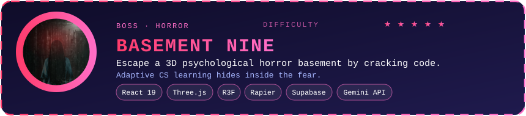
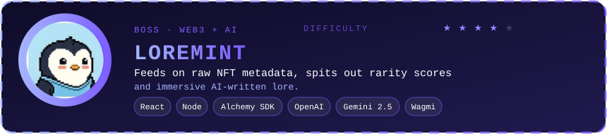
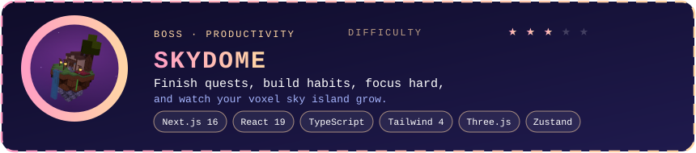

<!-- Wave header -->

  Hey there! I'm a <b>B.Tech Computer Engineering student at KJSSE, Mumbai</b> (CGPA: <b>9.57</b>). 
  I love turning ambitious ideas into usable, production-ready software  exploring <b>Full Stack Development</b>, <b>AI/ML</b>, <b>3D Web</b>, and <b>Quantum Computing</b>. Always building fast and leveling up every day!

 

 

